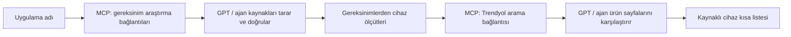

<div align="center">

# app-level

### Uygulama gereksinimlerinden cihaz araştırmasına — API anahtarı olmadan.

[](https://www.python.org/)
[](https://modelcontextprotocol.io/)
[](LICENSE.md)

</div>

Bir uygulama veya oyunun sistem gereksinimlerini araştırmak ve uygun cihazları Trendyol'da aramak için **iki MCP aracı**. Sunucu Google, Bing ve Trendyol'a açılan bağlantılar üretir; MCP istemciniz destekliyorsa bu bağlantıları açıp sonuçları kaynaklarıyla özetleyebilir.

> **API anahtarı gerekmez.** MCP sunucusu arama motorlarına istek göndermez; arama bağlantıları üretir. Sonuçları açıp inceleme, bağlandığınız GPT/ajan/uygulamanın web erişimine bağlıdır. Web erişimi olmayan bir istemci bağlantıları gösterir ama canlı araştırma yapamaz.

## Demo



### 1. Gereksinimleri araştır

```text
research_app_requirements(
  app_name="Minecraft: Java Edition",
  platform="computer"
)
```

Araç canlı gereksinim iddiasında bulunmaz; örneğin aşağıdaki türde tıklanabilir arama bağlantıları döndürür:

- Google ve Bing: resmi minimum gereksinimleri
- Google ve Bing: düşük ayarlar ve performans gereksinimleri
- Google ve Bing: mağaza/yayıncı listelemeleri

Bağlı GPT veya ajan web erişimine sahipse bu bağlantıları açıp **resmi yayıncı kaynağını önceleyerek** gereksinimleri kaynak linkleriyle raporlayabilir. Kaynaklarda bulunmayan RAM, işlemci, GPU veya FPS değerleri tahmin edilmemelidir.

### 2. Uygun cihazları ara

Araştırmada doğruladığınız gereksinimleri aramaya aktarın:

```text
search_trendyol_devices(
  search_terms="RTX 4060",
  device_type="laptop",
  minimum_ram_gb=16,
  minimum_storage_gb=512,
  budget_try=50000
)
```

Araç doğrudan Trendyol arama bağlantısı ile Google/Bing'de Trendyol listelemelerini arama bağlantıları döndürür. Web erişimi olan ajan ürün sayfalarını açıp modelleri kıyaslayabilir. Fiyatı, satıcıyı, ürünün tam modelini ve özelliklerini ürün sayfasında kontrol edin; arama bağlantısı **uyumluluk garantisi değildir**.

## MCP araçları

| Araç | Girdi | Çıktı |
|---|---|---|
| `research_app_requirements` | Uygulama/oyun adı, `auto` / `mobile` / `computer` platformu | Resmi gereksinim, düşük ayar ve mağaza araştırması için Google/Bing bağlantıları |
| `search_trendyol_devices` | Arama terimleri, telefon/dizüstü türü, isteğe bağlı RAM/depolama/bütçe | Trendyol arama sayfası ve Trendyol listelemeleri için Google/Bing bağlantıları |

## Kurulum

Python 3.10+ ve MCP Python SDK'sı gerekir. Brave hesabı, API anahtarı ve ücretli arama servisi gerekmez.

```powershell
python -m pip install "mcp[cli]<2"
```

### Yerel MCP istemcileri: stdio

VS Code, Claude Desktop veya yerel stdio MCP destekleyen istemcinizde sunucu dosyasının yolunu tanımlayın:

```json
{
  "servers": {
    "app-level": {
      "type": "stdio",
      "command": "python",
      "args": ["D:\\Projects\\app-level\\server.py"]
    }
  }
}
```

Bazı istemciler `servers` yerine `mcpServers` anahtarını kullanabilir; yapılandırmayı istemcinizin biçimine göre uyarlayın. İstemcinin ayrıca web/browsing aracı varsa, asistandan dönen bağlantıları açıp kaynakları doğrulamasını isteyin.

### Uzak MCP istemcileri: Streamable HTTP

ChatGPT gibi uzak MCP bağlayıcısı kullanan istemciler genellikle makinenizde çalışan stdio sürecine değil, erişilebilir HTTPS MCP adresine bağlanır. MCP SDK'sı zaten `streamable-http` desteğiyle gelir:

```powershell
$env:APP_LEVEL_TRANSPORT = "streamable-http"
$env:APP_LEVEL_HOST = "127.0.0.1"
$env:APP_LEVEL_PORT = "8000"
python server.py
```

Yerel uç nokta `http://127.0.0.1:8000/mcp` olur. Bu adres yalnızca aynı makineden erişim içindir; uzak bir istemciye bağlamak için sunucuyu HTTPS arkasında dağıtın, proxy alan adınızı izin verilen host listesine ekleyin (ör. `$env:APP_LEVEL_ALLOWED_HOSTS = "mcp.example.com:*"`) ve sağlayıcının istediği MCP adresini kullanın. Birden fazla host değerini virgülle ayırın. **Yerel `localhost` adresi internetteki GPT servisine erişilebilir değildir.** Genel ağa açarken kimlik doğrulamayı ve erişim kontrollerini hosting/reverse proxy katmanında yapılandırın; kimlik doğrulamasız açık sunucu olarak bırakmayın.

> Her GPT ürünü aynı özel MCP bağlantı yöntemini sunmaz. Uzak MCP/Streamable HTTP desteği ve bağlantı adımları kullandığınız ürünün planına ve ayarlarına bağlıdır.

## Skill dosyaları

Bu depoda iki yeniden kullanılabilir ajan becerisi bulunur:

- [`app-requirements-research`](.github/skills/app-requirements-research/SKILL.md): gereksinimleri arama, resmi kaynakları doğrulama ve belirsizliği belirtme.
- [`device-shortlist`](.github/skills/device-shortlist/SKILL.md): doğrulanmış gereksinimleri alışveriş ölçütlerine dönüştürme ve ürün sayfalarını kıyaslama.

Skill dosyaları Markdown biçimindedir. Bunları kullandığınız ajan platformunun skill/agent-skill dizinine ekleyin; platforma göre keşif yolu farklı olabilir.

## LinkedIn lansman belgesi

İngilizce, paylaşılmaya hazır proje tanıtımı ve LinkedIn post taslağı için [`LINKEDIN_LAUNCH.md`](LINKEDIN_LAUNCH.md) dosyasına bakın.

## Açık kaynak ve gizlilik

- Proje MIT lisansıyla yayımlanmıştır; ayrıntı: [`LICENSE.md`](LICENSE.md).
- MCP sunucusu arama sorgularını, sayfa içeriğini veya kişisel verileri herhangi bir arama API'sine göndermez. Arama motoruna veri gönderimi, bağlantıyı açan istemci/tarayıcı tarafından yapılır.
- Brave Search API anahtarı, ücretli servis veya Trendyol özel API erişimi yoktur.
- Sunucu sayfa kazımaz, stok/fiyat çekmez ve ürünün uygulamayla uyumlu olduğunu iddia etmez.
- Arama sonuçları güncel olmayabilir. Teknik gereksinimleri üreticiden/yayıncıdan, alışveriş ayrıntılarını ürün sayfasından doğrulayın.
