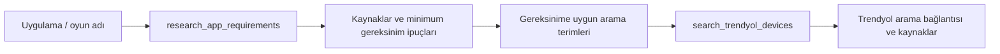

<div align="center">

# app-level

### Uygulama gereksinimlerinden cihaz araştırmasına, kaynaklı ve Türkçe.

[](https://www.python.org/)
[](https://modelcontextprotocol.io/)
[](https://www.trendyol.com/)

</div>

Bir uygulama veya oyunun **minimum sistem gereksinimlerini**, düşük ayarlarla ilgili kaynakları ve gereksinimlere göre **Trendyol cihaz arama sonuçlarını** MCP araçları üzerinden araştırın. Her sonuç bağlantısıyla gelir; araç doğrulanmamış teknik özellikleri gerçekmiş gibi sunmaz.

> **Önemli:** Arama sonuçları araştırmaya yardımcı olur, uyumluluk garantisi değildir. Özellikle oyunlardaki FPS, grafik ayarları ve telefon uyumluluğu sürüme ve cihaza göre değişir. Satın almadan önce resmi gereksinimleri ve ürün sayfasını kontrol edin.

## Akış



## MCP araçları

| Araç | Ne yapar? |
|---|---|
| `research_app_requirements` | Uygulama/oyun için minimum sistem gereksinimleri ve düşük ayar bilgilerini arar; kaynakları döndürür. |
| `search_trendyol_devices` | Verdiğiniz RAM, depolama ve bütçe ölçütleriyle Trendyol'a yönelik cihaz araması yapar. |

İki aracı art arda kullanın: önce gereksinimleri araştırın, sonra bulduğunuz ölçütleri ürün aramasına aktarın. Örneğin resmi gereksinimlerde en az 8 GB RAM yazıyorsa `minimum_ram_gb=8` belirtin. Araç, ürünün gerçekten uyumlu olduğunu otomatik olarak onaylamaz.

## Kurulum

Python 3.10+ ve bir Brave Search API anahtarı gerekir. MCP Python SDK'sını yükleyin:

```powershell
python -m pip install "mcp[cli]<2"
$env:BRAVE_SEARCH_API_KEY = "BRAVE_SEARCH_API_ANAHTARINIZ"
```

API anahtarını kaynak koda veya GitHub'a eklemeyin. Arama, Brave Search API üzerinden yapılır; API erişimi ve kullanım kotası Brave hesabınıza bağlıdır.

## MCP istemcisine bağlama

Örnek stdio yapılandırması (Windows; yolları kendi kurulumunuza göre değiştirin):

```json
{
  "servers": {
    "app-level": {
      "type": "stdio",
      "command": "python",
      "args": ["D:\\Projects\\app-level\\server.py"],
      "env": {
        "BRAVE_SEARCH_API_KEY": "BRAVE_SEARCH_API_ANAHTARINIZ"
      }
    }
  }
}
```

İstemciniz `mcpServers` anahtarını veya farklı bir yapılandırma biçimini bekliyorsa, aynı `command`, `args` ve `env` değerlerini istemcinizin biçimine uyarlayın.

## Örnek kullanım

Önce gereksinim araştırması:

```text
research_app_requirements(
  app_name="Örnek Oyun",
  platform="computer",
  max_results=5
)
```

Sonra araştırmada bulunan gereksinimlerle Trendyol araması:

```text
search_trendyol_devices(
  search_terms="RTX 4060",
  device_type="laptop",
  minimum_ram_gb=16,
  minimum_storage_gb=512,
  budget_try=50000
)
```

Araç sonucu, arama sorgusunu, kaynak bağlantılarını ve doğrudan Trendyol arama sayfasını verir. Fiyat ve ürün özellikleri değişebileceğinden son kontrolü Trendyol'da yapın.

## Sınırlar ve gizlilik

- Yalnızca Brave Search API ve herkese açık arama sonuçları kullanılır; Trendyol'un özel API'sine erişilmez ve sayfa kazıma/erişim kontrollerini aşma yapılmaz.
- Ürün listelemeleri arama sonuçlarından gelir; stok, satıcı, fiyat ve teknik özellikler doğrulanmış kabul edilmez.
- Resmi yayıncı gereksinimleri önceliklidir. Kaynak bulunamazsa araç sonuç olmadığını gösterir; gereksinim uydurmaz.
- Uygulama adları ve arama sorguları arama sağlayıcısına iletilir. Hassas bilgi göndermeyin.
- Bu depoda kaynak olarak yalnızca Python ve Markdown dosyaları bulunur. GitHub README'si Mermaid diyagramı ve rozetleri görsel olarak işler; gerçek video/fotoğraf dosyası eklenmemiştir.
